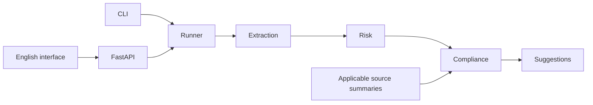

<!-- Modified for the English text/TXT demo; scope and behavior are documented in README.md. -->

# Multi-Agent Contract Review

[GitHub repository](https://github.com/XiangL72/multi-agent-contract-review) · Static walkthrough source: [site/](site/README.md)

A fixed four-agent workflow for English-language purchase/sale contract review within a mainland-China legal scope: **extraction → risk → compliance candidates → suggestions**.

## Status and scope

The English interface, model instructions, drafting heuristics, and keyword retrieval are implemented. Offline tests exercise software behavior using fake models. The frontend has been exercised locally with the offline model substitute. A two-input fictional live rerun completed both workflows after optional-numbering and compliance-scope fixes. Semantic review still found a capped-liability category error and proposed revisions that lost supplied facts. The subsequent consistency checks have been tested offline only. No live English accuracy claim is made.

- Mainland-China law only; knowledge cutoff **2026-10-20**. Canadian-law processing is future work.
- Pasted text and UTF-8 TXT only: 15,000 Unicode characters; TXT up to 65,536 bytes. No PDF, Word, or OCR support.
- Three reviewed **Chinese Civil Code summaries**. They are summaries, not exact statute quotations. English glosses are explicitly **unreviewed translations**; only original summary text is citable.
- English completeness rules use simple presence heuristics. Explicit numeric **CNY/RMB** prices are recognized; other currencies, amounts written in words, and complex formulae are outside the demo's price heuristic. Unrecognized information becomes a candidate for manual checking, not proof that a contractual term is absent or legally required.
- The compliance stage returns **drafting/completeness candidates only**, always `needs_review`. It uses the three available summaries as context, not as proof of legal validity, mandatory terms, or arbitration requirements. Source labels are filled from validated citation metadata.
- Obvious English legal-verdict/mandatory-rule phrases and `compliant` / `non_compliant` findings are isolated. Their result uses `out_of_scope_findings` and `partial`, with a `COMPLIANCE_SCOPE_REJECTED` diagnostic. Invalid citations still use `invalid_citations`; mixed rejection reasons remain visible in diagnostics. Valid candidates can be retained alongside rejected ones.
- This conservative phrase screen can over-reject benign wording and miss unsupported paraphrases or factual mistakes. `grounded` means retrieval and these mechanical checks completed, **not** that the source semantically proves a conclusion. Risk and suggestion output remain model-generated drafts requiring review.
- `success` means the workflow completed, not that the contract is lawful or risk-free. Findings and revision drafts require human examination and are not legal advice.

## Architecture



The Runner shares input validation, execution state, and a per-review request budget across the CLI and API. Four fixed LangGraph nodes run serially; the model does not autonomously choose the next node. Contract spans must match the normalized input. Knowledge citations must belong to this run's retrieved context and quote its original text exactly. Matching text does not prove that a legal interpretation is correct.

The request cap is eight model attempts, including retries. Transient errors may retry once; SDK retries are disabled. Per-call timeout is at most 30 seconds and the review deadline is 120 seconds. Local cancellation does not guarantee provider-side cancellation or refunds. No matching knowledge produces `partial` / `evidence_insufficient` and skips the compliance model call.

## Quick start: no API key

Use Python 3.11 and Node.js 20.9 or newer. The frontend uses Next.js 16.4.5 and React 19 with Webpack. Python constraints record the resolved macOS/Python 3.11 environment; other platforms still need verification.

```sh
cd python
python3 -m venv .venv
source .venv/bin/activate
pip install -r requirements.txt
python -m src.cli --mock --file ../examples/purchase-missing-price.txt
```

`--mock` executes the workflow with a deterministic model substitute. Its output marks `mock: true`; scripted findings demonstrate control flow and evidence handling, not live model analysis. See the [demo guide](docs/demo.md) for examples and the [English presentation script](docs/presentation.md) for a local walkthrough and interview questions.

## Static presentation website

The [static walkthrough](site/README.md) presents selected recorded results, architecture and limitations without a backend or model calls. Preview it with `python3 -m http.server 8765 --bind 127.0.0.1 --directory site` from the repository root. This presentation is distinct from the live processing interface below.

## Real processing and local web interface

From the project root:

```sh
cp python/.env.example python/.env
```

Edit the local `.env` to select your provider, model, and credentials. Real processing sends input to the configured external provider and may incur charges. Use fictional or authorized inputs only. Never commit `.env`, put secrets in frontend code, or expose a provider key through a `NEXT_PUBLIC_` variable.

From `python/`, with the virtual environment active:

```sh
python -m src.cli --real --file ../examples/purchase-missing-price.txt --max-calls 4
python -m src.api.main
```

In another terminal:

```sh
cd frontend
npm ci
npm run dev
```

Open http://localhost:3000. The API defaults to http://localhost:8000; health is `/api/v1/health`, and API documentation is `/docs`. The frontend defaults to that API URL and submits **real processing**, without an offline selector. English explanatory text accompanies original Chinese source-summary quotations where applicable.

`POST /api/v1/review` accepts `{"text":"..."}`. `POST /api/v1/review/upload` accepts UTF-8 TXT. Each submission returns the full result directly. There is no GET-by-ID endpoint or backend review history. Completed and partial results return 200; failed reviews 502; timeouts 504. Input errors return 422, oversize input 413, unsupported upload extensions 415, and unknown IDs 404. CLI exit codes: 0 success, 2 partial, 1 failure/input error, 124 timeout.

## Error handling

Failed stages return stable error codes and generic messages. Model payloads, rejected values, and raw exception text are excluded from application errors/logs. Failed and timed-out HTTP submissions return the same full result shape as completed submissions, with available diagnostics, using 502 and 504 respectively. Successful and partial responses use 200. The response includes `Cache-Control: no-store`. A `review_id` identifies the execution only; it cannot retrieve a saved result.

## Verification

```sh
cd python
.venv/bin/python -m pytest tests -q
cd ../frontend
npm ci
npm run build
```

The candidate passed 130 offline tests on 2026-11-07. The frontend passed a Next.js 16 production build earlier that day; subsequent changes affected backend checks and documentation. Python constraints were verified in the fresh Python 3.11 environment. The upgraded frontend also passed a clean npm install on the current Mac. The updated frontend dependency tree returned zero listed vulnerabilities in npm audit; this is not a security guarantee. Software tests use fake models and synthetic fixtures. New English fixture expectations are engineering candidates with review status `pending`; previous Chinese label approvals do not transfer to them. No model-quality or legal-accuracy metric is claimed.

## Continuous integration

The GitHub workflow in `.github/workflows/ci.yml` runs Python 3.11 offline tests on macOS and a Node.js 22 frontend build on Ubuntu for pushes and pull requests. It also checks the static walkthrough JavaScript syntax. Tests use synthetic model substitutes; no provider credentials are configured. Dependency installation requires network access. The workflow has read-only repository permissions and does not deploy anything. Local checks passed; the hosted workflow remains unverified until the first approved push.

## Local-use limitations

The backend processes each request transiently and returns the result without retaining review history. The frontend holds results only in the current page; refresh or a new submission clears that page state. The application does not deliberately save uploads, but multipart parsing may use temporary disk before validation. The CLI writes a result file only when explicitly given `--output`. External model providers may retain inputs under their own policies. There is no authentication, global concurrency/rate limit, persistent storage, or production deployment configuration. Existing text/TXT checks remain; early transport-level body validation is deferred. The default host is loopback; do not expose this backend publicly. The current review found no credential/internal-material pattern matches and no listed PyPI advisories for the 54 resolved Python packages. Public deployment safeguards and final publication checks remain outstanding. This project has not received a complete security clearance.

### Conservative consistency checks

An unlimited-liability model finding that contradicts recognized capped or negated wording stops the risk stage with an explicit error. An affirmative uncapped obligation elsewhere in the same clause is retained for review. This phrase check does not resolve parties, exceptions, cross-clause obligations, or every form of liability wording.

Proposed revisions must retain detected numeric tokens, common numeric periods/quantities, common currency codes, and English quantities such as “one unit.” Comma formatting such as 1000/1,000 is normalized. Missing or changed values fail the suggestion stage and produce a partial result; rejected drafts are not shown as successful revisions. New or changed commercial terms are explicitly labeled as proposals requiring party confirmation and legal review. The model is instructed to preserve other supplied facts and mark new terms individually, but runtime checks do not prove it complied.

These lexical checks can reject legitimate rewording or intentional numeric changes. They can also miss changed names, unsupported legal assertions, altered relationships, or numbers retained in the wrong context. Added terms are not validated as legally necessary or appropriate. Source text and evidence are preserved separately; examine the diff and seek human review. No additional repair requests are made.
